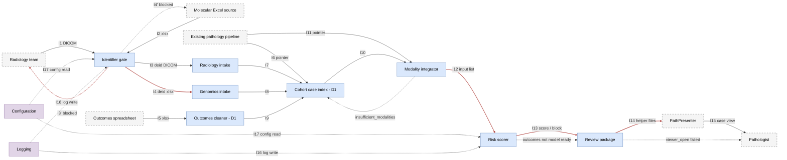
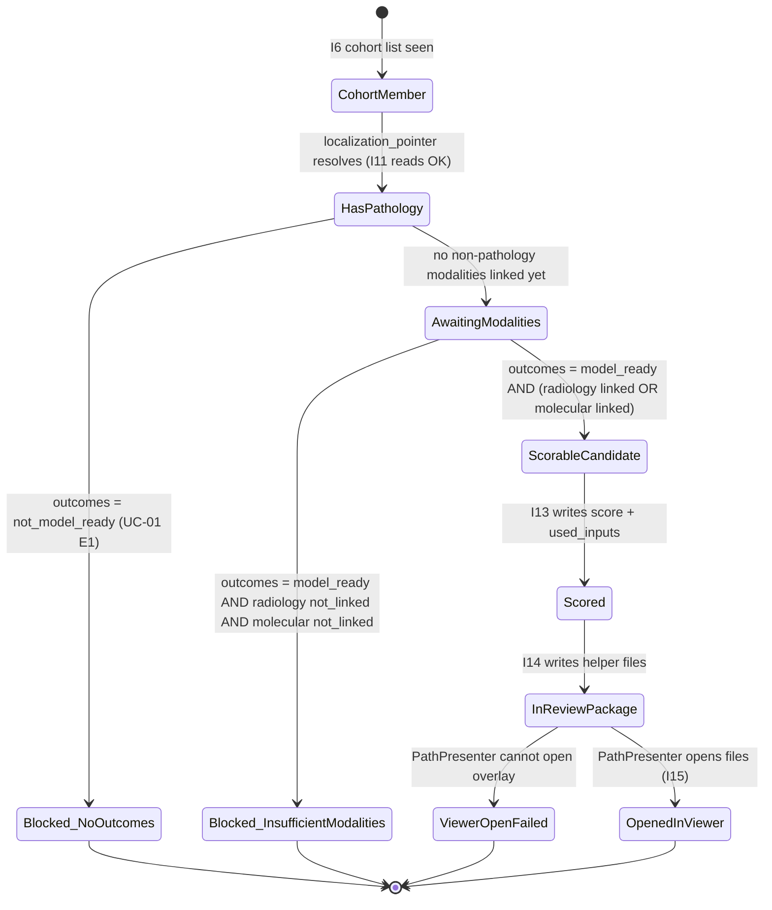

# D2 Detailed Design

**Project:** HepatoFusion
**Team members:** Shivam Sinay Kharangate, Nipun Chandra
**Partner:** Cincinnati Children’s Hospital
**Document:** Design D2 (Week 8). Sits beside `D0_High_Level_Design` and `D1_Detailed_Design`. Does not overwrite them (no errata were filed from the peer review that touched D0 or D1 text).

**AI use.** An AI tool helped draft this document and the figures. The partial-score rule change, the identifier-gate deidentification approach, the modality-integrator contract for pre-annotated DICOM, the edge-case decisions, the traceability mapping, and the rationale are the team's decisions. The tool wrote the structure; the team made the calls.

---

## Team decisions used in this document

These are the choices the team made going into D2. The rest of the document follows them.

| Topic | Team decision |
|---|---|
| D2 scope | Finish detailed design for every D0 component the team did not already detail in D1: Identifier gate, Radiology intake, Genomics intake, Modality integrator, Risk scorer, Review package. Also treat the glue components with the same care: Authentication, Notifications, Configuration, Logging. |
| Partial-score rule (replaces D0 D-06 working assumption) | A score is produced only when **pathology + cleaned outcomes + at least one of {radiology, molecular}** are all present. A case with pathology + outcomes but no radiology and no molecular is **not scored**; the integrator writes `insufficient_modalities` and the scorer does not run. |
| Identifier gate behavior | The gate **deidentifies** per Cincinnati Children’s instructions (removal of MRN, address, and other hospital-assigned identifiers). The exact field list is pending clarification from Cincinnati Children’s and is treated as configuration (open question OQ-01). If a required identifier cannot be removed (e.g., burned-in pixel text in a DICOM), the file is **blocked**, not guessed. |
| Risk scorer model | The scorer’s **interface** is specified in D2. The **model** is not: the team is still comparing candidates on a holdout and will record the winner before Week 9. The interface treats the model as a swappable callable so model changes do not change file schemas. |
| Modality integrator contract for radiology | A DICOM arrives at the integrator only when it is already annotated — either annotated at source or annotated afterward with the oncologist / specialist. The integrator **does not run its own feature extractor on raw DICOM**. If no annotation is present, radiology stays `not_linked` for that case. |
| PathPresenter wiring | We have account access to PathPresenter. We do **not** yet have the agreed import format for the pathology localization and score helper; the IT team conversation is in progress. The review-package interface is specified in D2 but the exact file layout for PathPresenter is a named open question (OQ-02). |
| Glue — Authentication | No app-level auth. All access is through hospital/UC SSO on approved shared folders. The gate, intake, index, integrator, scorer, and review package all inherit folder ACLs. |
| Glue — Notifications | No push notifications or email. Status is readable from log files and from each component’s per-run status JSON. Human users read these as needed. |
| Glue — Configuration | Single YAML file (`pipeline_config.yaml`) under the approved share. Loaded at startup of every stage. Covers paths, agreed field list, identifier rules, and model version pointer. |
| Glue — Logging | Python `logging` module. Per-component, per-run log file under `v1/logs/<component>/<run_id>.log`. Retention policy is deferred (OQ-03). |
| What is **not** modified in D0 and D1 | Nothing. The peer review did not flag an errata that requires editing D0 or D1 text. (If a reviewer flags such an edit before submission, D2’s rationale will mark it.) |

---

## 1. Header, scope, and conventions

**Title:** HepatoFusion

**Goal (same wording as D0 and D1):** Put an infrastructure in place for radiology, molecular data, and cleaned clinical outcomes on the existing pediatric liver-cancer cohort, then integrate those modalities with the finished pathology localization so a pathologist can use a research risk score as a helper. The finished pathology U-Net is also planned to surface inside PathPresenter (QuPath is the alternative viewer still under consideration), so the localization is available in the systems pathologists already use.

**Scope of D2.** The six D0 components deferred by D1 — Identifier gate, Radiology intake, Genomics intake, Modality integrator, Risk scorer, Review package — are detailed here with a data model (or `no persistent data`), a behavior (step list / state machine / algorithm), and an interface (file schemas, logical operations, errors). Four glue components called out by the Week 8 brief — Authentication, Notifications, Configuration, Logging — are also detailed, scoped to what a two-person research pipeline on approved shared storage actually needs. D2 also delivers the edge-case table, the requirements traceability table, the design rationale, and the peer design review notes.

**Conventions on every figure (reused from D0 and D1, extended for D2):**

- A **solid rectangle** is a component the team will build (or an entity when the figure is a data-model sketch).
- A **dashed rectangle** is an external system (PathPresenter, the existing pathology pipeline, radiology team, molecular Excel source, outcomes spreadsheet, hospital data-use reviewer).
- An **arrow** is a file written into the case folder on approved CCHMC / UC shared storage, labelled with its interface ID (I1 … I18).
- A **red arrow or red state** indicates an **error path** (new in D2 — see §2.11 and the state machine in §2.1).
- A **rounded rectangle** in a state machine is a state; the transition label is the event or outcome that moves to the next state.
- `study_id` is the internal cohort key. Patient name, MRN, DOB, and street address are **not** attributes of any entity in this document (US-05, Week 3 privacy).
- Interface IDs **I1 … I15** are those defined in D0. D2 adds **I16, I17, I18** for glue (logging write, config read, status read), to make the file-based “method surface” explicit rather than implied.

**Two-minute overview for a reviewer with no context.** HepatoFusion is a file pipeline that collects three new modalities (radiology, molecular, clinical outcomes) on an existing 102+ patient pediatric-liver-cancer cohort whose pathology U-Net is already built and already produces tumor-localization maps. New files arrive one modality at a time, get deidentified by an identifier gate, land in a per-case folder keyed by `study_id`, and are indexed by a `Cohort case index`. When a case has enough linked modalities, a `Modality integrator` builds an input list, a `Risk scorer` returns one score (or a block reason), and a `Review package` makes the existing localization and the score available to the pathologist through PathPresenter. **D1 detailed** the data model (Cohort case index) and the outcomes join-and-clean algorithm. **D2 detailes** everything else, including the deidentification gate, the two file-level intake components, the integrator-and-scorer pair, the review-package handoff to PathPresenter, and the four glue components. **Not in D2:** the final risk-model choice (interface only), the final list of identifier fields from Cincinnati Children’s (configured, not hard-coded), and the PathPresenter import file format (open question with IT in progress).

**Known gaps and open questions (listed up front so a reviewer does not have to find them).**

| ID | Open question | Owner | Why it is still open |
|---|---|---|---|
| OQ-01 | Exact identifier-field list Cincinnati Children’s requires removed by the gate | Shivam (clinical liaison) | Awaiting written guidance from CCHMC. The gate reads the list from `pipeline_config.yaml` so the rule can be filled in without a code change. |
| OQ-02 | PathPresenter import file format for localization overlay + score helper | Shivam + CCHMC IT | Access to the tool is live; the specific overlay format (GeoJSON, XML, proprietary export) is still under discussion with IT. |
| OQ-03 | Log retention and rotation policy on the approved share | Nipun | Depends on share quota and institutional retention rules; stub value is 90 days. |
| OQ-04 | Final risk-scorer model (logistic / GBM / small MLP) | Both | Comparison on holdout is running; D2 fixes the interface so the model is swappable. |
| OQ-05 | Whether QuPath wiring moves from “alternate” to “wired” if PathPresenter blocks | Both | Deferred until OQ-02 resolves. |

---

## 2. Finished components (D2 diagrams and specs)

> Convention reminder: every subsection below gives **(a) data model**, **(b) behavior**, **(c) interface and errors** for one component. “No persistent data” is used when a component only moves bytes without owning entities.

### 2.1 Overview figure — components and error paths

The figure below shows all 10 components (6 D0 components previously deferred, 2 D1 components already detailed, 2 of the 4 glue components that are on the data path). **Red arrows mark error paths** and satisfy the Week 8 rule that at least one diagram shows error paths, not only the happy path.



A corresponding **state machine** for a Case (the entity with the most interesting lifecycle in the whole system) is below. Red states are terminal non-scoring outcomes.



Editable source: `D2_diagrams.drawio` (sheets **D2 Component Error Paths** and **D2 Case Lifecycle**).

---

### 2.2 Identifier gate (US-05, D0 I1 / I2, extended by D2 I3 / I4)

**(a) Data model.**

| Entity | Keys / fields | Notes |
|---|---|---|
| **GateRecord** | `(incoming_path, received_at)` PK; `study_id`, `format` ∈ {`DICOM`, `xlsx`}, `decision` ∈ {`passed`, `blocked`, `passed_with_redaction`}, `block_reason?`, `operator`, `rule_set_version` | Written next to the file as `gate_status.json`. One per attempted intake. |
| **RedactionEntry** | `(gate_record_id, field_type)` PK; `field_type` ∈ {`MRN`, `name`, `DOB`, `address`, `institutional_id`, `other`}, `action` ∈ {`removed`, `blanked`, `uid_replaced`}, `location_hint` | Stored inside `gate_status.json`. Never stores the identifier value itself. |

The gate holds **no PHI at rest**. The rule set it applies is read from `pipeline_config.yaml` (`identifier_rules`, see §2.9) so OQ-01 is resolved by a config change, not a code change.

**(b) Behavior (step list).**

1. Pick up file from `incoming/<study_id>/`.
2. Validate format. DICOM is expected on the radiology side; xlsx is expected on the molecular side. Any other type ⇒ `blocked`, reason `E_UNKNOWN_FORMAT`.
3. For DICOM: walk the metadata tags in `identifier_rules.dicom_tags`; for each matching tag, apply the rule (remove, blank, or replace with a generated UID). If pixel data contains burned-in text (OCR hit against the `identifier_rules.burned_in_patterns` list) ⇒ **block**, reason `E_PIXEL_IDENTIFIER`, because D2 does not attempt to redact pixels.
4. For xlsx: scan the first `identifier_rules.xlsx_scan_rows` rows for identifier columns (header match + regex content match). If a column of type `MRN`, `name`, `DOB`, or `address` is present with any non-empty cell, drop the whole column. If a column type cannot be deidentified by removal (`identifier_rules.require_block` list) ⇒ block.
5. Write `gate_status.json`. On `passed` or `passed_with_redaction`, copy the file to `accepted/<study_id>/<format>/`. On `blocked`, leave the file in `incoming/<study_id>/` and never copy it.
6. Append a log line via I16 (`component: gate`, run id).

**(c) Interface and errors.**

Logical operations:

| Name | Inputs | Outputs | Errors |
|---|---|---|---|
| `scan_and_deidentify` | `incoming_path`, `study_id`, `format`, `rule_set_version` | `gate_status.json`, deidentified file in `accepted/…` (or no file + block in `incoming/…`) | `E_UNKNOWN_FORMAT`, `E_PIXEL_IDENTIFIER`, `E_REDACTION_FAILED`, `E_CONFIG_MISSING_RULES`, `E_IO` |
| `status_for` | `incoming_path` | `gate_status.json` content | `E_NOT_FOUND` |

Status file schema (`v1/incoming/<study_id>/<file>.gate_status.json`):

| Field | Type | Required | Valid range |
|---|---|---|---|
| `study_id` | string | yes | Non-empty, no PHI |
| `format` | string | yes | `DICOM` \| `xlsx` |
| `decision` | string | yes | `passed` \| `passed_with_redaction` \| `blocked` |
| `block_reason` | string \| null | yes | One of the error codes above when blocked |
| `redactions` | array | yes | Zero or more `{field_type, action, location_hint}`; identifier values never stored |
| `rule_set_version` | string | yes | Version string from `pipeline_config.yaml` |

**D0 I1 / I2 interfaces revisited.** D0 described these as pass/block only. The D2 revision replaces the pass/block binary with a three-way outcome (`passed`, `passed_with_redaction`, `blocked`) because deidentification is a routine outcome, not a bug path, and reviewers should see redactions in the status file. The parameter count stayed small; no internals leak (the identifier **values** are never written out).

---

### 2.3 Radiology intake (US-03, D0 I3, D0 I7)

**(a) Data model.**

| Entity | Keys / fields | Notes |
|---|---|---|
| **RadiologyRecord** | `(study_id)` PK; `modality_type` ∈ {`CT`, `MRI`}, `source_path` (post-gate), `annotation_status` ∈ {`present`, `pending`, `not_required`}, `annotation_path?`, `link_status` ∈ {`linked`, `not_linked`, `unmatched`}, `received_at` | Written to `v1/cases/<study_id>/radiology.json`. Lives inside the case folder. |

The intake does **not** convert DICOM. Conversion is still an open research question (D0 D-04).

**(b) Behavior (step list).**

1. Watch `accepted/<study_id>/DICOM/` for a new gate-accepted file.
2. Resolve `study_id` against the cohort list from the Cohort case index (D1). Exactly one hit ⇒ `link_status = linked`. Zero hits ⇒ `unmatched`. More than one hit ⇒ `unmatched` with log reason `ambiguous_cohort_match`. (The D0 wording “does not guess a match” is preserved.)
3. Check the sibling folder `accepted/<study_id>/annotations/` for an annotation artifact that references this DICOM (filename convention `<dicom_uid>.annot.json`). If present ⇒ `annotation_status = present`, record the path. If absent ⇒ `annotation_status = pending`.
4. Write `radiology.json`. Emit I7 to the Cohort case index (`modality=radiology`, status set from `link_status`, `annotation_status` tagged along).
5. The integrator (§2.5) is the one that enforces the “annotated DICOM only” contract. Intake records state; it does not reject on missing annotation.

**(c) Interface and errors.**

| Name | Inputs | Outputs | Errors |
|---|---|---|---|
| `register_radiology` | `study_id`, deidentified DICOM path, cohort list | `radiology.json`, I7 payload to Cohort case index | `E_UNMATCHED_STUDY`, `E_AMBIGUOUS_STUDY`, `E_IO`, `E_SCHEMA` |
| `read_radiology` | `study_id` | `radiology.json` content | `E_NOT_FOUND`, `E_SCHEMA` |

Schema `v1/cases/<study_id>/radiology.json`:

| Field | Type | Required |
|---|---|---|
| `study_id` | string | yes |
| `modality_type` | `CT`\|`MRI` | yes |
| `source_path` | string | yes |
| `annotation_status` | `present`\|`pending`\|`not_required` | yes |
| `annotation_path` | string \| null | no |
| `link_status` | `linked`\|`not_linked`\|`unmatched` | yes |
| `received_at` | ISO-8601 string | yes |

---

### 2.4 Genomics intake (US-02, D0 I4, D0 I8)

**(a) Data model.**

| Entity | Keys / fields | Notes |
|---|---|---|
| **GenomicsRecord** | `(study_id)` PK; `format` = `xlsx`, `source_path` (post-gate), `link_status`, `received_at` | Written to `v1/cases/<study_id>/molecular.json`. |

Other molecular file formats remain **blocked** at the gate (D0 D-05).

**(b) Behavior.** Same structure as radiology intake, minus the annotation-status field (the molecular workbook is itself the input the integrator wants). On registration, link to one cohort case or mark `unmatched`; emit I8 to Cohort case index.

**(c) Interface and errors.**

| Name | Inputs | Outputs | Errors |
|---|---|---|---|
| `register_molecular` | `study_id`, deidentified xlsx path, cohort list | `molecular.json`, I8 payload | `E_UNMATCHED_STUDY`, `E_AMBIGUOUS_STUDY`, `E_IO`, `E_SCHEMA` |
| `read_molecular` | `study_id` | `molecular.json` content | `E_NOT_FOUND`, `E_SCHEMA` |

---

### 2.5 Modality integrator (US-02, D0 I10, D0 I11, D0 I12)

**(a) Data model.**

| Entity | Keys / fields | Notes |
|---|---|---|
| **IntegratedInputList** | `(study_id, assembled_at)` PK; `inputs: list[InputRef]`, `viewer_target` = `PathPresenter`, `assembly_decision` ∈ {`sufficient`, `insufficient_modalities`, `outcomes_not_ready`}, `rule_set_version` | Written to `v1/cases/<study_id>/input_list.json`. |
| **InputRef** | `name` ∈ {`pathology_localization`, `radiology`, `molecular`, `clinical_outcomes`}; `status` ∈ {`linked`, `not_linked`, `unmatched`, `model_ready`, `not_model_ready`}; `source?`; `format?` | Record of what will be passed into scoring. |

**(b) Behavior (algorithm + decision).**

```text
read case_link.json
read pathology pointer via I11

inputs = []
inputs += ref(pathology_localization, "linked" if pointer resolves else "unmatched")
inputs += ref(radiology, radiology.link_status; omit if intake missing)
inputs += ref(molecular, molecular.link_status; omit if intake missing)
inputs += ref(clinical_outcomes, outcomes.status)

# D2 partial-score rule (replaces D0 D-06 working assumption)
has_pathology    = inputs[pathology_localization].status == "linked"
has_outcomes     = inputs[clinical_outcomes].status == "model_ready"
has_radiology    = inputs[radiology].status == "linked" and annotation_status == "present"
has_molecular    = inputs[molecular].status == "linked"

if not has_pathology:
    decision = "unmatched"               # the system does not run at all without pathology
elif not has_outcomes:
    decision = "outcomes_not_ready"      # UC-01 E1
elif not (has_radiology or has_molecular):
    decision = "insufficient_modalities" # NEW D2 rule (option b)
else:
    decision = "sufficient"

write input_list.json with inputs + decision
```

The “radiology counts only when its annotation is `present`” clause is the D2-specified contract for pre-annotated DICOM: a raw DICOM with no annotation is treated as `not_linked` for scoring, because the integrator does not run its own feature extractor.

**(c) Interface and errors.**

| Name | Inputs | Outputs | Errors |
|---|---|---|---|
| `assemble_input_list` | `study_id` | `input_list.json` | `E_PATHOLOGY_POINTER_MISSING`, `E_CASE_FOLDER_MISSING`, `E_SCHEMA`, `E_IO` |
| `read_input_list` | `study_id` | `input_list.json` content | `E_NOT_FOUND` |

Schema `v1/cases/<study_id>/input_list.json`:

| Field | Type | Required | Notes |
|---|---|---|---|
| `study_id` | string | yes | |
| `inputs` | array | yes | List of InputRef |
| `viewer_target` | string | yes | `PathPresenter` in D2 |
| `assembly_decision` | string | yes | One of `sufficient`, `insufficient_modalities`, `outcomes_not_ready`, `unmatched` |
| `rule_set_version` | string | yes | Points at the rule set that produced this decision |
| `assembled_at` | ISO-8601 | yes | |

**D0 I12 revisited.** D0 said the integrator still emits the list even when outcomes are not model-ready, and the scorer refuses. D2 keeps that split (integrator emits, scorer refuses on `outcomes_not_ready`), but also lets the integrator short-circuit before scoring with `insufficient_modalities`, so the scorer never sees a case that cannot meet the partial-score rule. Parameter count is unchanged.

---

### 2.6 Risk scorer (US-02, D0 I12, D0 I13)

**(a) Data model.**

| Entity | Keys / fields | Notes |
|---|---|---|
| **ScoreResult** | `(study_id, scored_at)` PK; `score: float \| null`, `used_inputs: list[string]`, `block_reason: string \| null`, `model_version: string \| null`, `disclaimer: string`, `rule_set_version: string` | Written to `v1/cases/<study_id>/score_result.json`. |

The scorer **has no training data on disk**; it loads a pre-trained model artifact pointed at by `model_version` from `pipeline_config.yaml`. The specific model is OQ-04.

**(b) Behavior (step list).**

1. Read `input_list.json`. Verify `assembly_decision`:
   - `unmatched` ⇒ do not run; return `block_reason = "case not in cohort"`.
   - `outcomes_not_ready` ⇒ do not run; return `block_reason = "clinical outcomes not model-ready"` (UC-01 E1 wording preserved).
   - `insufficient_modalities` ⇒ do not run; return `block_reason = "insufficient modalities (require pathology + outcomes + at least one of radiology/molecular)"`.
   - `sufficient` ⇒ proceed.
2. Load the model artifact named by `model_version`. If the artifact cannot be loaded ⇒ `E_MODEL_LOAD`.
3. Build the feature vector from the `used_inputs` only. If an expected feature is missing when it should have been linked ⇒ `E_FEATURE_MISSING` (do not fabricate zeros).
4. Call `model.predict`. Expect a scalar in `[0, 1]`. Values outside that range ⇒ `E_MODEL_OUT_OF_RANGE`.
5. Write `score_result.json` with the score, the exact `used_inputs` list, the `model_version`, and the disclaimer `"research prototype, not a diagnostic device"`.
6. Append a log line via I16 containing `score_result.json` path only (no PHI, no raw features).

**(c) Interface and errors.**

| Name | Inputs | Outputs | Errors |
|---|---|---|---|
| `score_case` | `study_id`, `model_version` (from config) | `score_result.json` | `E_INPUT_LIST_MISSING`, `E_MODEL_LOAD`, `E_FEATURE_MISSING`, `E_MODEL_OUT_OF_RANGE`, `E_IO` |
| `read_score` | `study_id` | `score_result.json` content | `E_NOT_FOUND`, `E_SCHEMA` |

Schema `v1/cases/<study_id>/score_result.json`:

| Field | Type | Required | Valid range |
|---|---|---|---|
| `study_id` | string | yes | |
| `score` | number \| null | yes | `[0.0, 1.0]` when not null |
| `used_inputs` | array[string] | yes | Subset of `{pathology_localization, radiology, molecular, clinical_outcomes}` |
| `block_reason` | string \| null | yes | Null when `score` is set |
| `model_version` | string \| null | yes | Null when blocked |
| `disclaimer` | string | yes | Must contain “research prototype, not a diagnostic device” |
| `rule_set_version` | string | yes | |
| `scored_at` | ISO-8601 | yes | |

---

### 2.7 Review package (US-01, D0 I13, D0 I14, D0 I15)

**(a) Data model.**

| Entity | Keys / fields | Notes |
|---|---|---|
| **ReviewPackage** | `(study_id, built_at)` PK; `localization_pointer`, `score_result_path`, `viewer_target` = `PathPresenter`, `package_status` ∈ {`built`, `viewer_open_failed`, `partial_no_score`}, `disclaimer`, `files_written: list[string]` | Written to `v1/cases/<study_id>/review_package.json`. |

**(b) Behavior (step list).**

1. Read `score_result.json`. The score may be null; the review package still runs so US-01 (pathologist sees the existing localization) is served.
2. Read the localization pointer from the Cohort case index.
3. Produce the helper files PathPresenter needs. **Exact file layout is OQ-02.** D2 assumes a GeoJSON overlay next to a one-page JSON helper (`score`, `used_inputs`, `block_reason`, `disclaimer`). When OQ-02 resolves, only this file-format step changes.
4. Try to open the files inside PathPresenter (manual step by Shivam in D2; automation deferred). If PathPresenter refuses the overlay ⇒ `package_status = viewer_open_failed`, leave the files in the case folder; do not auto-fall-back to QuPath (D0 D-08 preserved).
5. If the score was null, `package_status = partial_no_score`: the localization still goes to PathPresenter, the score field in the helper JSON stays null, and the block reason is displayed verbatim.

**(c) Interface and errors.**

| Name | Inputs | Outputs | Errors |
|---|---|---|---|
| `build_review_package` | `study_id` | `review_package.json`, overlay + helper files under `v1/cases/<study_id>/review/` | `E_LOCALIZATION_UNRESOLVED`, `E_SCORE_FILE_MISSING`, `E_OVERLAY_WRITE`, `E_IO` |
| `mark_viewer_result` | `study_id`, `opened: bool`, `note?` | Updated `review_package.json.package_status` | `E_NOT_FOUND` |

Schema `v1/cases/<study_id>/review_package.json`:

| Field | Type | Required | Notes |
|---|---|---|---|
| `study_id` | string | yes | |
| `localization_pointer` | string | yes | Path on the approved share |
| `score_result_path` | string \| null | yes | Null when score missing |
| `viewer_target` | string | yes | `PathPresenter` |
| `package_status` | string | yes | `built` \| `viewer_open_failed` \| `partial_no_score` |
| `files_written` | array[string] | yes | Paths of overlay + helper JSON |
| `disclaimer` | string | yes | Always present |
| `built_at` | ISO-8601 | yes | |

**D0 I14 revisited.** D0 noted a `viewer_open: failed` state. D2 upgrades that into a first-class `package_status` enum including `partial_no_score`, so a pathologist opening the case always sees a reason the score is missing instead of an empty field.

---

### 2.8 Glue — Authentication

**(a) Data model.** No persistent data. Access is governed by the hospital / UC SSO on the approved shared folder; the pipeline does not store users, roles, or tokens.

**(b) Behavior.** Every component call runs under the invoking user’s SSO. Reads and writes against the approved share are allowed or denied by the folder ACL — not by any application check. The team does not hand-roll authentication (course guidance; D1 §4).

**(c) Interface and errors.** No in-pipeline interface. Observable error from the OS layer is `E_PERMISSION_DENIED`, surfaced upward by whichever component attempted the read or write; that component logs the error via I16 and halts the stage. No retry on permission errors.

---

### 2.9 Glue — Configuration

**(a) Data model.** One YAML file at `v1/config/pipeline_config.yaml`, versioned alongside the schema folder.

| Section | Keys |
|---|---|
| `paths` | `approved_root`, `incoming_root`, `cases_root`, `logs_root`, `cohort_list_path` |
| `identifier_rules` | `rule_set_version`, `dicom_tags`, `burned_in_patterns`, `xlsx_scan_rows`, `require_block` |
| `agreed_fields` | `rule_set_version`, `fields: [name, type, coded]` |
| `scoring` | `model_version`, `require_partial_score_modalities: ["radiology"|"molecular"]` (default both allowed, require at least one) |
| `logging` | `level`, `retention_days` (default 90, OQ-03) |

**(b) Behavior.** Each component calls `load_config()` at startup. The returned object is immutable for the lifetime of a run; a change requires a new run. `rule_set_version` is written into every component’s output JSON so a reviewer can tell which config produced which result.

**(c) Interface and errors.**

| Name | Inputs | Outputs | Errors |
|---|---|---|---|
| `load_config` | path to `pipeline_config.yaml` | parsed config object | `E_CONFIG_NOT_FOUND`, `E_CONFIG_SCHEMA`, `E_CONFIG_PATH_INVALID` |
| `get_rule_set_version` | config object | string | — |

(New interface ID **I17** on the overview figure: config read.)

---

### 2.10 Glue — Logging

**(a) Data model.** Log files under `v1/logs/<component>/<run_id>.log` using the Python stdlib `logging` module. Each line is structured:

```
<ISO-8601 timestamp> | <component> | <run_id> | <study_id or ->  | <level> | <event> | <message>
```

**No PHI** is permitted in the message field. Reviewers rely on `study_id` only.

**(b) Behavior.** On entry, every component opens a log file for `(component, run_id)`. On every state-changing step, it writes a line. On exit, the log file is closed and left on disk. Retention policy is OQ-03; the stub value is 90 days.

**(c) Interface and errors.**

| Name | Inputs | Outputs | Errors |
|---|---|---|---|
| `get_logger` | `component`, `run_id` | logger handle | `E_LOG_PATH_INVALID` |
| `log_event` | logger, level, event, message | written line | — |

(New interface ID **I16**: log write.)

---

### 2.11 Glue — Notifications

**(a) Data model.** No persistent data. No notifications are emitted.

**(b) Behavior.** The pipeline does **not** send email, chat messages, or push notifications. Status is readable from the per-component status JSON (`gate_status.json`, `radiology.json`, `molecular.json`, `input_list.json`, `score_result.json`, `review_package.json`) and from the per-run log files. A human (team member or pathologist) reads these on demand.

**(c) Interface and errors.** Only one logical operation exists so other components can request a status summary without reaching into every JSON themselves:

| Name | Inputs | Outputs | Errors |
|---|---|---|---|
| `read_case_status` | `study_id` | Combined status for the case (gate + intake + outcomes + input list + score + review package) | `E_NOT_FOUND`, `E_SCHEMA` |

(New interface ID **I18**: status read.)

**Rationale for no notifications.** The pipeline is batch, not real-time; the pathologist’s workflow is to open PathPresenter when they are reading a case, not to be paged. Adding email or chat notifications would require configuring a notification channel that we do not currently have approved for PHI-adjacent events.

---

## 3. Edge cases and error handling

Every component is covered against the four categories from class: **boundary values, timing and concurrency, bad or missing input, external dependencies**. Each row names a handler and marks recoverable (R) vs. not-recoverable (N).

| ID | Component | Category | Edge case | Design decision | Handler | R/N |
|---|---|---|---|---|---|---|
| E-01 | Identifier gate | Boundary | Zero-byte file in `incoming/` | Block with `E_UNKNOWN_FORMAT`; status written; file remains in `incoming/` | `scan_and_deidentify` | R |
| E-02 | Identifier gate | Boundary | Workbook with 500 sheets or DICOM with 10,000 frames | Scan rows capped at `identifier_rules.xlsx_scan_rows`; DICOM metadata parsed, pixels only sampled per `burned_in_patterns`; if time budget exceeded, block with `E_REDACTION_FAILED` | `scan_and_deidentify` | R |
| E-03 | Identifier gate | Timing / concurrency | Two files arrive simultaneously for the same `study_id` | Each gets its own `GateRecord`; writes are atomic (`.part` then rename); last-writer-wins is explicitly **disallowed** by the suffix (`<file>.gate_status.json`), so no record is overwritten | `scan_and_deidentify` | R |
| E-04 | Identifier gate | Bad / missing input | DICOM with a burned-in patient name in the image | Block; `block_reason = E_PIXEL_IDENTIFIER`; file not copied | `scan_and_deidentify` | N |
| E-05 | Identifier gate | External dependency | `pipeline_config.yaml` is missing or unreadable | Component refuses to start: `E_CONFIG_MISSING_RULES`; no file is written, no file is accepted; log line emitted. The gate must **not** run with a defaulted rule set | `load_config` → `scan_and_deidentify` | R |
| E-06 | Radiology intake | Boundary | DICOM with a study ID whose folder does not exist yet | Create case folder on demand under `v1/cases/<study_id>/`; register with `in_cohort=false` if the ID is not in the cohort list | `register_radiology` | R |
| E-07 | Radiology intake | Timing / concurrency | Intake runs while an annotation is being written next door | Intake re-reads `annotation_status` on completion of the annotation watcher’s rename; the integrator (not intake) is the one that waits on `annotation_status = present` | `register_radiology` + integrator | R |
| E-08 | Radiology intake | Bad / missing input | A `.dcm` file that is really a JPEG | Rejected at the gate (I3 never emits it); if it slips through, intake raises `E_SCHEMA` and does not write `radiology.json` | `register_radiology` | R |
| E-09 | Radiology intake | External dependency | Cohort list file not reachable | Mark `link_status = unmatched`; emit I7 with `unmatched`; do **not** guess a match (D0 preserved) | `register_radiology` | R |
| E-10 | Genomics intake | Boundary | Empty workbook (zero data rows) | Register as `linked` if the ID resolves, but downstream outcomes-cleaner behavior governs model readiness; genomics does not evaluate contents in D2 | `register_molecular` | R |
| E-11 | Genomics intake | Timing / concurrency | Two different workbooks arrive for the same `study_id` within one minute | Second write triggers `E_AMBIGUOUS_STUDY` on registration; both are logged; a human resolves | `register_molecular` | R |
| E-12 | Genomics intake | Bad / missing input | `.xls` (not `.xlsx`), `.csv`, or other molecular file types | Blocked by gate (D0 D-05); never arrives | gate | N |
| E-13 | Genomics intake | External dependency | Share mount drops partway through write | Writes use `.part` + rename; on crash, partial file is detected on restart (missing `.json` sidecar) and discarded | `register_molecular` | R |
| E-14 | Outcomes cleaner (D1) | Boundary | Spreadsheet with duplicate `study_id` rows | Both excluded with `ambiguous_join` (D1 ALG-01 preserved) | `run_outcomes_clean` | R |
| E-15 | Outcomes cleaner (D1) | Timing / concurrency | Cleaner run A still writing while run B starts | Each run writes to its own `v1/logs/outcomes_exclusions/<run_id>.jsonl`; outputs under `v1/cases/<study_id>/outcomes.json` use `.part` + rename | `run_outcomes_clean` | R |
| E-16 | Outcomes cleaner (D1) | Bad / missing input | Join column missing | `E_MISSING_JOIN_COLUMN`, no partial run | `run_outcomes_clean` | R |
| E-17 | Outcomes cleaner (D1) | External dependency | Cohort list file empty | `E_EMPTY_COHORT`, no run | `run_outcomes_clean` | N |
| E-18 | Cohort case index (D1) | Boundary | A case with every modality `unmatched` and no outcomes | Index records the state; the integrator decides whether to proceed (it will not, see E-24) | Cohort case index | R |
| E-19 | Cohort case index (D1) | Timing / concurrency | Two writers updating the same `case_link.json` | Writers acquire a filesystem lock (`fcntl.flock`) on the file for the write window; conflicting writes serialize | `validate_and_write_case_link` | R |
| E-20 | Cohort case index (D1) | Bad / missing input | `study_id` does not match folder name | `E_ID_MISMATCH`; write refused (D1 preserved) | `validate_and_write_case_link` | R |
| E-21 | Cohort case index (D1) | External dependency | Pathology pointer resolves to a path that no longer exists | Record `localization_pointer=null`; the integrator will block on `E_PATHOLOGY_POINTER_MISSING` (E-26) | Cohort case index | R |
| E-22 | Modality integrator | Boundary | Case with pathology linked, outcomes model-ready, radiology linked but annotation **pending** | `insufficient_modalities` unless molecular is linked. Pre-annotated DICOM contract is strict (OQ-04 does not change this) | `assemble_input_list` | R |
| E-23 | Modality integrator | Timing / concurrency | A modality status changes between the read of `case_link.json` and the write of `input_list.json` | Integrator writes a `read_at` timestamp alongside its output; a later integrator run supersedes it. No locking required — this is a snapshot operation | `assemble_input_list` | R |
| E-24 | Modality integrator | Bad / missing input | `case_link.json` missing entirely | `E_CASE_FOLDER_MISSING`; nothing written downstream | `assemble_input_list` | R |
| E-25 | Modality integrator | External dependency | Pathology pointer (I11) does not resolve on read | `E_PATHOLOGY_POINTER_MISSING`; the integrator does not emit an input list, and the scorer does not run (D0 D-01 preserved: the finished U-Net is not retrained) | `assemble_input_list` | N |
| E-26 | Risk scorer | Boundary | Model returns `score = 1.0` or `0.0` exactly | Allowed; `[0, 1]` is inclusive | `score_case` | R |
| E-27 | Risk scorer | Timing / concurrency | Two concurrent scoring runs for the same case | Each writes a different `(study_id, scored_at)` tuple into `score_result.json`; the review-package reads the latest by `scored_at`; older runs are preserved for audit | `score_case` + `build_review_package` | R |
| E-28 | Risk scorer | Bad / missing input | `input_list.json` says `sufficient` but a feature is missing | `E_FEATURE_MISSING`; **do not** fabricate zeros (US-02 explicitly: missing modality must not be treated as present) | `score_case` | N |
| E-29 | Risk scorer | External dependency | Model artifact file missing | `E_MODEL_LOAD`; score blocked with that reason; review package still built with no score (`partial_no_score`) so pathologist still sees localization | `score_case` + `build_review_package` | N |
| E-30 | Review package | Boundary | Score is exactly 0.5 or null | Rendered as “0.50” or “no score” plus block reason; no special rounding | `build_review_package` | R |
| E-31 | Review package | Timing / concurrency | Pathologist opens PathPresenter while review package is being updated | File writes use `.part` + rename; PathPresenter will open the version at the time of open; a later update will not corrupt an in-flight read | `build_review_package` | R |
| E-32 | Review package | Bad / missing input | Localization pointer null (pathology run never completed) | `E_LOCALIZATION_UNRESOLVED`; no review package; the Case stays in `HasPathology=false` and does not reach `InReviewPackage` | `build_review_package` | N |
| E-33 | Review package | External dependency | PathPresenter cannot read the overlay | `package_status = viewer_open_failed`; files remain in `review/`; **no automatic fallback to QuPath** (D0 D-08 preserved); human decides next step | `mark_viewer_result` | R |
| E-34 | Configuration (glue) | Boundary | A new rule-set version is deployed between stages of one case | Each stage records its `rule_set_version`; downstream stage detects the mismatch at read time and logs a warning; the case is still processed because the pipeline is not required to be transactional across stages | `load_config` | R |
| E-35 | Configuration (glue) | Timing / concurrency | `pipeline_config.yaml` is edited mid-run | Each component’s `load_config()` is cached for its run; the edit affects the **next** run only. No partial-config state | `load_config` | R |
| E-36 | Configuration (glue) | Bad / missing input | YAML with unknown top-level keys | `E_CONFIG_SCHEMA`; refuse to run. Unknown keys are not tolerated silently | `load_config` | R |
| E-37 | Configuration (glue) | External dependency | Approved share root unmounted | All components fail with `E_IO`; no component attempts partial work | every component | R |
| E-38 | Logging (glue) | Boundary | A log line longer than 64 KB (unlikely; from a very large payload trace) | Line truncated to 8 KB; a trailing `...truncated` marker is appended | `log_event` | R |
| E-39 | Logging (glue) | Timing / concurrency | Two components log for the same `study_id` at the same time | Each component owns its own log file; no cross-component contention | `get_logger` | R |
| E-40 | Logging (glue) | Bad / missing input | A caller tries to log a value that contains an identifier (name, MRN) | A sanitizer regex in `log_event` strips values matching `identifier_rules.burned_in_patterns`; the stripped value is replaced with `[REDACTED]`; log line still goes out | `log_event` | R |
| E-41 | Logging (glue) | External dependency | Log directory not writable | Component falls back to STDERR and sets its stage status to `warning`; it does **not** halt — the pipeline is still able to produce the case artifacts, and the log is best-effort | `get_logger` | R |
| E-42 | Authentication (glue) | External dependency | SSO expires mid-run | Next FS operation returns `E_PERMISSION_DENIED`; component halts; a human re-authenticates and the run is restarted | OS → component | R |
| E-43 | Notifications (glue) | Bad / missing input | A caller requests a status summary for a `study_id` that does not exist | `E_NOT_FOUND`; empty summary not fabricated | `read_case_status` | R |

**Totals**: 43 rows, every component × every category.

---

## 4. Requirements traceability

Every requirement (functional and non-functional) maps to one or more design elements (an entity, a schema field, an algorithm, an edge-case row, or a figure) — not a bare component name. Gaps are explained in the last column.

### 4.1 Forward: requirement → design elements

| Req ID | Short text | Priority | Design elements | How it is satisfied |
|---|---|---|---|---|
| US-01 | Pathologist sees existing tumor localization as helper while reading a WSI | Must | §2.7 ReviewPackage; §2.1 state `InReviewPackage` → `OpenedInViewer`; E-32, E-33 | `build_review_package` writes the localization overlay and helper JSON into `v1/cases/<study_id>/review/`; `OpenedInViewer` state marks the pathologist’s open event; failure path makes the overlay still available on the share even when PathPresenter rejects it |
| US-02 | Case-level risk estimate names only inputs actually used | Must | §2.5 IntegratedInputList.inputs + assembly_decision; §2.6 ScoreResult.used_inputs; D2 partial-score rule (option b); E-28 | `input_list.json.inputs[*].status` ∈ {`linked`, `not_linked`, `unmatched`, `model_ready`}; the scorer’s `used_inputs` is the exact subset consumed; the integrator refuses to assemble a scorable list if pathology + outcomes + (radiology or molecular) are not all present |
| US-03 | Radiology study linked to one existing cohort case | Should | §2.3 RadiologyRecord.link_status; D1 Cohort case index I7; E-06, E-09 | `link_status ∈ {linked, not_linked, unmatched}`; unmatched is never silently guessed; the index records the state |
| US-04 | Each outcomes row reduced to agreed fields, joined to exactly one case | Must | D1 ALG-01; D1 OutcomesRow + ExclusionLogEntry; E-14, E-16, E-17 | Join by `study_id`, agreed-field readiness check, exclusion log; detailed in D1 §3 and preserved unchanged in D2 |
| US-05 | New radiology / molecular files blocked when direct patient identifier present | Must | §2.2 GateRecord.decision; §2.2 RedactionEntry; §2.9 identifier_rules; E-04, E-05 | Gate performs deidentification per `identifier_rules` (OQ-01) and emits `passed`, `passed_with_redaction`, or `blocked`; burned-in pixel identifiers block (E-04); no PHI is written out |
| UC-01 | Produce a case risk estimate from inputs on hand | Must | §2.5 + §2.6 + §2.7; state machine §2.1 | Main success flow = `Scorable → Scored → InReviewPackage → OpenedInViewer`; A1 (no radiology) handled by partial-score rule (requires molecular); E1 (outcomes not model-ready) ⇒ `Blocked_NoOutcomes` |
| UC-02 | Make the clinical-outcomes table model-ready | Must | D1 ALG-01; D1 OutcomesRow + ExclusionLogEntry; E-14 … E-17 | Detailed in D1; preserved in D2 without change |
| AC-01.1 | Full input list produces exactly one score + prototype disclaimer | Must | §2.6 ScoreResult.score + used_inputs + disclaimer | Schema enforces: `score` single number in `[0,1]`, `used_inputs` array, `disclaimer` present string |
| AC-01.2 | Blocked-outcomes case returns no score + reason “clinical outcomes not model-ready” | Must | §2.5 assembly_decision = `outcomes_not_ready`; §2.6 block_reason wording | Scorer refuses, exact wording preserved from UC-01 E1 |
| AC-01.3 | No-radiology case: radiology reported as `not linked`, not in used_inputs | Must | §2.5 assembly_decision + inputs[radiology].status; D2 partial-score rule | Radiology omitted from used_inputs when not linked; molecular must be linked for scoring to proceed under option (b) |
| AC-02.1 | Fully clean spreadsheet: kept == source rows, excluded == 0 | Must | D1 ALG-01 summary; D1 §3 output structure | Summary dict `{source_rows, kept, excluded}` is written on every run |
| AC-02.2 | Row with unmatched join: absent from model-ready, exclusion log `unmatched` | Must | D1 ALG-01 ExclusionLogEntry; E-14 | Preserved from D1 |
| NFR-PHI | No PHI on personal devices or in course repo (Constraints essay; US-05) | Must | §2.2 (no identifier values written); §2.10 (log sanitizer E-40); §2.9 (approved_root paths); D1 §6 | Approved shared folder only; identifier values never persisted; log sanitizer strips any accidental leaks |
| NFR-COMPUTE | Training and inference on approved institutional / hospital compute only | Must | §2.9 paths.approved_root; §2.6 model artifact loaded from the share; D1 §6 | Pipeline path config pins the approved root; no consumer cloud API appears in any interface |
| NFR-OPEN-SOURCE | Open-source stack (PyTorch, pandas, openpyxl); no new vendor | Should | D1 §4; §2.6 model_version pointer | Build-vs-reuse table in D1; D2 only adds Python stdlib `logging` and PyYAML |
| NFR-RESEARCH | Research prototype; no FDA / diagnostic claims | Must | §2.6 ScoreResult.disclaimer; §2.7 ReviewPackage.disclaimer; §2.2 gate wording | Disclaimer appears on every scored and every reviewed case; schema requires the field |
| NFR-FOLDER-VERSIONS | Breaking schema change requires a new folder root | Should | §2.9 paths.cases_root under `v1/`; D1 §5 versioning | New folder root (`v2/`) for breaking changes; non-breaking changes add optional fields |
| NFR-AUDIT | Every scored case can be traced back to the config that produced it | Should | §2.6 ScoreResult.rule_set_version; §2.5 IntegratedInputList.rule_set_version; §2.9 | Every output JSON carries the rule-set version |

### 4.2 Reverse: design element → requirement (scope-creep check)

| Design element | Requirement(s) it serves | Notes |
|---|---|---|
| Identifier gate (§2.2) | US-05, NFR-PHI | — |
| Radiology intake (§2.3) | US-03, US-02 (via linked radiology), NFR-COMPUTE | — |
| Genomics intake (§2.4) | US-02 (via linked molecular), NFR-COMPUTE | — |
| Outcomes cleaner (D1 §3) | US-04, UC-02, AC-02.1, AC-02.2 | — |
| Cohort case index (D1 §2) | US-02, US-03, US-04 (via join), NFR-FOLDER-VERSIONS | — |
| Modality integrator (§2.5) | US-02, UC-01 (A1 and E1), AC-01.3, NFR-AUDIT | — |
| Risk scorer (§2.6) | US-02, UC-01, AC-01.1, AC-01.2, NFR-RESEARCH, NFR-AUDIT | — |
| Review package (§2.7) | US-01, UC-01 postcondition, NFR-RESEARCH | — |
| Authentication (§2.8) | NFR-PHI, NFR-COMPUTE | Delegates to SSO; no in-pipeline logic beyond propagating permission errors |
| Configuration (§2.9) | US-05 (identifier_rules), NFR-AUDIT, NFR-FOLDER-VERSIONS, OQ-01 | — |
| Logging (§2.10) | NFR-AUDIT, NFR-PHI (sanitizer) | — |
| Notifications (§2.11) | — (no requirement forces this) | **This is the only design element without a strict requirement behind it.** It exists because the Week 8 brief lists notifications as a glue component to treat. The team deliberately kept it at “no notifications emitted + one status-read interface” so that it is not scope creep — only a defensible scoping choice. |

---

## 5. Design rationale

Six to ten significant decisions from D1 and D2, each in “chose X over Y because … accepted trade-off … because …” form. Decisions the team **changed** or **tightened** since D0 or D1 are marked. (Peer review did not drive a decision change at the time of writing; if that changes before submission, the marker will be added here and the Peer_Review_Notes file.)

| ID | Decision | Form |
|---|---|---|
| R-01 | **Deidentify rather than only block** at the identifier gate (D2 refinement of D0 I1 / I2). | We chose **in-place deidentification with a block fallback** over **block-only on identifier presence** because the files Cincinnati Children’s sends routinely contain identifier metadata that can be stripped (MRN, address, hospital-assigned IDs), and treating every such file as a block would reject the normal case. We accepted the trade-off of maintaining an explicit `identifier_rules` config section and a `RedactionEntry` audit record because without the audit a reviewer could not tell what was actually removed. Pending OQ-01, the rule set version is the only guarantee a reviewer has that the rule was correct. |
| R-02 | **Partial-score rule tightened to require pathology + outcomes + (radiology OR molecular)** (replaces D0 D-06 working assumption). | We chose **option (b)** over **(a) score whenever outcomes are model-ready** because a case with no imaging and no molecular data in effect scores on pathology + outcomes only, which the team no longer thinks is a fair “multimodal” risk estimate. We accepted the trade-off of **fewer cases being scorable in the near term** because the Project Description’s unit of value is a *fused* estimate, and emitting a score that fuses nothing is misleading even when correctly annotated. |
| R-03 | **Integrator contract: DICOM must be annotated before it counts as `linked` for scoring** (new in D2). | We chose a **pre-annotated DICOM contract** over **in-pipeline feature extraction from raw DICOM** because annotation is already happening upstream (oncologist / specialist, or the radiology team at source), and reproducing that annotation inside the pipeline would ship a model we do not maintain. We accepted the trade-off of **more cases marked `pending`** because the alternative is to invent a feature extractor whose quality the team cannot vouch for before the risk model is even chosen. |
| R-04 | **Risk-scorer model is a swappable callable; model choice deferred** (new in D2 — scoped away from D1 §4 candidate list). | We chose **interface-first, model-TBD** over **picking a model now** because the team is still comparing candidates on a holdout and the result changes which features matter. We accepted the trade-off of **leaving OQ-04 open through D2** because fixing a model inside the interface spec would require a schema change the first time the comparison picks a different winner. The interface writes `model_version` into every result so the choice is traceable once made. |
| R-05 | **PathPresenter is the first viewer; QuPath remains an alternate; no automatic fallback** (D0 D-08 preserved, with D2 making the fallback explicitly manual). | We chose **a manual fallback to QuPath** over **an automatic switch** because an automatic switch would make it impossible to tell, from the output alone, which viewer actually opened the case. We accepted the trade-off of **requiring a human to decide** on `viewer_open_failed` because for a two-person research project with no deployed service, a human is already in the loop every time a case is reviewed. |
| R-06 | **No notifications; status is pulled, not pushed** (new in D2 — glue component scoping). | We chose **status-read endpoints only** over **email or chat notifications** because PHI-adjacent notifications would need a notification channel the team does not currently have approved, and the pipeline is batch, not real-time. We accepted the trade-off of **requiring a reader to open the status file** because the alternative pulls the project into infrastructure (SMTP, Slack webhook) that neither the schedule nor the data-use rules allow. |
| R-07 | **One configuration file; no secrets inside it** (new in D2). | We chose **one YAML config under the approved share** over **environment variables per component** because the components all run on the same approved compute and the config is better reviewed as a whole than as a scatter of env values. We accepted the trade-off of **a single-file bottleneck** because `rule_set_version` and schema-root versioning (`v1/`) are the lines reviewers actually audit, and keeping them in one file makes that audit faster. The file holds no credentials — those stay in SSO. |
| R-08 | **Log retention is a config value with a default of 90 days** (new in D2). | We chose **a config-driven retention default** over **a hard-coded value** because the share’s quota and the institutional retention rules are not final (OQ-03). We accepted the trade-off of **not committing to a number in D2** because logs on an approved share must be governed by whatever rule CCHMC lands on, not by the team’s preference. |
| R-09 | **File-based “status read” is the only cross-component API** (new in D2 — I18). | We chose **one JSON reader (`read_case_status`)** over **per-component CLI tools** because a reviewer and the pathologist both benefit from one surface that aggregates the state of the case, instead of six JSONs they have to open individually. We accepted the trade-off of **centralizing a tiny amount of logic** because it beats the alternative where every reviewer learns six file formats to understand one case. |
| R-10 | **No modification to D0 or D1 in D2** (D2 submission policy). | We chose **leaving D0 and D1 as the historical record** over **rewriting them with D2’s decisions in-line** because the course guidance is to carry errata into D2 only when the peer review surfaces one, and the peer review has not surfaced one at the time of writing. We accepted the trade-off of **a reader seeing D0 D-06’s working assumption and R-02’s tighter rule side by side** because the alternative hides the fact that the rule evolved — which is exactly the kind of signal reviewers should see. |

(Count: 10 entries — within the required 6–10 range.)

---

## 6. Peer design review notes

> **Status for this version of the file:** scaffolded, not filled in. The peer review for Week 7 was not consolidated at the time of writing. After the session, the team will replace this section with the action-item table below and will update R-10 and the Team-decisions table above if the review surfaces an errata for D0 or D1.
>
> The full consolidated review (feedback received from every reviewing team plus the top two issues the team raised while reviewing others) will live in `Peer_Review_Notes.md` beside this file. This section mirrors that file so the final consolidated PDF has everything the Week 8 rubric asks for.

### 6.1 Action items from feedback the team received

| ID | Criterion (completeness / feasibility / clarity / risk) | Issue (one sentence) | Raised by (team) | Action | Owner | Priority (must-fix / worth considering / out of scope) | Due |
|---|---|---|---|---|---|---|---|
| PR-01 | _[to fill]_ | _[to fill]_ | _[team]_ | _[action verb + concrete artifact]_ | _[Nipun / Shivam]_ | _[priority]_ | _[date]_ |
| PR-02 | | | | | | | |
| PR-03 | | | | | | | |

### 6.2 Summary

- **Criterion that drew the most feedback:** _[to fill]_
- **Top two issues the team raised while reviewing others:** _[to fill]_
- **Must-fix items applied to D2 before submission:** _[to fill — none yet]_

---

## Appendix A — Interface ID table (D0 + D2 additions)

| ID | From → to | Status |
|---|---|---|
| I1 | Radiology team → Identifier gate | D0; D2 refined (passed_with_redaction) |
| I2 | Molecular Excel source → Identifier gate | D0; D2 refined |
| I3 | Identifier gate → Radiology intake | D0; D2 added `annotation_status` propagation |
| I4 | Identifier gate → Genomics intake | D0 |
| I5 | Outcomes spreadsheet → Outcomes cleaner | D0 (detailed in D1 §5) |
| I6 | Existing pathology pipeline → Cohort case index | D0 |
| I7 | Radiology intake → Cohort case index | D0 |
| I8 | Genomics intake → Cohort case index | D0 |
| I9 | Outcomes cleaner → Cohort case index | D0 (D1 §5) |
| I10 | Cohort case index → Modality integrator | D0 |
| I11 | Existing pathology pipeline → Modality integrator | D0 |
| I12 | Modality integrator → Risk scorer | D0; D2 extended `assembly_decision` enum |
| I13 | Risk scorer → Review package | D0; D2 upgraded `block_reason` wording |
| I14 | Review package → PathPresenter | D0; D2 added `partial_no_score` and `files_written` |
| I15 | PathPresenter → Pathologist | D0 |
| **I16** | Any component → Logging | **New in D2** |
| **I17** | Any component → Configuration | **New in D2** |
| **I18** | Any component or human → Notifications (`read_case_status`) | **New in D2** |

---

## Appendix B — File / schema inventory under `v1/`

```
v1/
├── config/
│   └── pipeline_config.yaml                    (§2.9)
├── incoming/
│   └── <study_id>/
│       ├── <file>                              (pre-gate)
│       └── <file>.gate_status.json             (§2.2)
├── accepted/
│   └── <study_id>/
│       ├── DICOM/<file>                        (post-gate)
│       └── xlsx/<file>                         (post-gate)
├── cases/
│   └── <study_id>/
│       ├── case_link.json                      (D1 §5)
│       ├── radiology.json                      (§2.3)
│       ├── molecular.json                      (§2.4)
│       ├── outcomes.json                       (D1 §5)
│       ├── input_list.json                     (§2.5)
│       ├── score_result.json                   (§2.6)
│       ├── review_package.json                 (§2.7)
│       └── review/
│           ├── <localization>.geojson          (OQ-02)
│           └── helper.json                     (OQ-02)
├── cohort_study_ids.json                       (D1 §5)
└── logs/
    ├── gate/<run_id>.log
    ├── radiology/<run_id>.log
    ├── molecular/<run_id>.log
    ├── outcomes/<run_id>.log                   (D1)
    ├── integrator/<run_id>.log
    ├── scorer/<run_id>.log
    └── review/<run_id>.log
```
